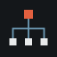

<p align="center">
  
</p>

<h1 align="center">CortexManage</h1>

<p align="center">
  <strong>The manager that develops the Cortex apps with a local model.</strong><br/>
  You describe a change; it plans it, has CortexCode build it, and checks every step. No cloud.
</p>

<p align="center">
  <a href="https://github.com/agentbusiness/CortexManage">github.com/agentbusiness/CortexManage</a> ·
  <a href="LICENSE.txt">Apache-2.0</a>
</p>

---

## Why CortexManage

A coding agent is good at one change. Running several apps means many changes at once: requests
that overlap, a shared standard that has to stay the same in every repository, releases that need
to go out in order. CortexManage does that work around the agent, so a person decides only what
matters.

- **A request is a chat.** You describe a change in a session under its repository. Nothing else to
  fill in.
- **Rated and planned.** Each request is rated (kind, impact, surface, urgency) and planned with
  walks: the steps through the real app that prove it works. What the product does not need is cut.
- **Held, then built.** Related requests wait together and go out as one package. A running
  [CortexCode](https://github.com/agentbusiness/CortexCode) (the runner) builds it in its own clones.
- **Watched at every step.** CortexManage follows the build as it happens. Done means the checks,
  the builds and the walks passed.
- **You are asked only when it counts:** a major change, or something stuck.

## How the model is kept in check

- **The model never decides a gate.** A model's yes or no must name a line that code then finds.
- **The model that reads a request has no tool that writes.** Only planning has tools, and only for
  reading.
- **CortexManage never edits code.** Every change is made by CortexCode, in its own clones, on its
  own branch.
- **A fixed ladder when a build goes wrong:** steer once, restart once, then a person.
- **Decisions are schema-bound.** Plans, ratings and verdicts are decoded against a schema.

## What it is made of

A Rust frame that runs everything as plugins, and an Electron window: the same skeleton as
CortexCode, [CortexTerm](https://github.com/agentbusiness/CortexTerm) and
[CortexModelServer](https://github.com/agentbusiness/CortexModelServer), on the same mesh standard.

| Plugin | What it does |
|---|---|
| `manage` | Requests, packages, the hold, the job on the runner, the watch, gates, the inbox |
| `chatflow-manage` | The model's questions: assess, match, plan, validate, drift, converge |
| `charter` | Each app's rules and proposals; prints `AGENTS.md`; checks |
| `standard` | `standard.lock` and the checks that keep the apps on one mesh standard |
| `release-train` | Soak and the daily release train |
| the rest | The shared plugins of the Cortex apps, unchanged |

Everything it keeps is in a local graph. Secrets stay in the Keychain.

## The model

CortexManage's own questions (rating, planning, checking) go to the shared **Gemma** office model
of your mesh, the one CortexTerm uses; it carries Gemma itself and uses another app's copy on the
same computer instead of loading a second. Building is CortexCode's, on its Qwen coding model. Model
calls are claimed in the background, so a person's turn in another app always goes first.

## Who it is for

- People who run several apps and want a local agent to do the routine development work.
- Anyone who wants the plan, the build and the proof kept apart, with code deciding what passed.

## Requirements

- A Mac with Apple silicon.
- A running CortexCode, and a GPU on your mesh with its coding model, to build.

## Install

```sh
npx cortexmanage
```

The first run downloads the app for your machine from this repository's releases, checks it
against the checksum in the release catalog and starts it; later runs start the installed app at
once, and the app updates itself. From this repository, `./cortexmanage` does the same.

Updates come by themselves. A plugin you have not changed updates as soon as no run is going; a
plugin you changed asks first (merge the update into your change, or keep yours). A new frame
waits for *Restart to update*.

## Building

```sh
scripts/build-app.sh build
```

makes `build/CortexManage.app` (the frame, the shell and every plugin packed). Its home is
`~/.cortexmanage`.

## Releasing

Everything is built on a Mac with Apple silicon; Linux builds run in Docker on it. Each plugin is
released on its own, so a change to one plugin builds only that plugin. The frame is a small core:
the frame and its Electron shell. `scripts/release/digest.mjs` says what each part is built from.

| Script | What it releases |
|---|---|
| `scripts/release.sh` | **whatever changed since the last release**, in order: frame, plugins, app, npx (`--plan` says what, `--dry-run` builds without uploading) |
| `scripts/release-plugin.sh <plugin> [version]` | one plugin (`--changed`: every plugin whose source changed) |
| `scripts/release-frame.sh [version]` | the frame and its Electron shell |
| `scripts/release-app.sh [version]` | the full app for new users (`.tar.gz`; `.dmg` with `RELEASE_DMG=yes`), from the released parts |
| `scripts/release-npm.sh [version]` | the `npx cortexmanage` launcher |

Without a version each takes the next one after the released one: three numbers, each 0 to 99
(`0.3.99` is followed by `0.4.0`). Every script takes `--dry-run` (build into `artifacts/`, upload
nothing). Configuration: `.env.release` (see `.env.release.example`).

## Status

CortexManage is in early development. Expect fast changes and rough edges.

## License

Apache License 2.0. See [LICENSE.txt](LICENSE.txt).

CortexManage's memory runs on [IronGraph](https://github.com/agentbusiness/IronGraph). Third-party
components keep their own licenses.
